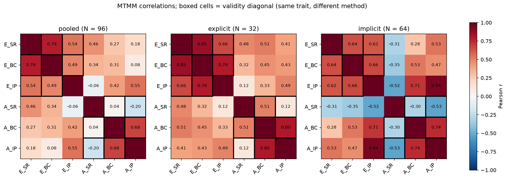
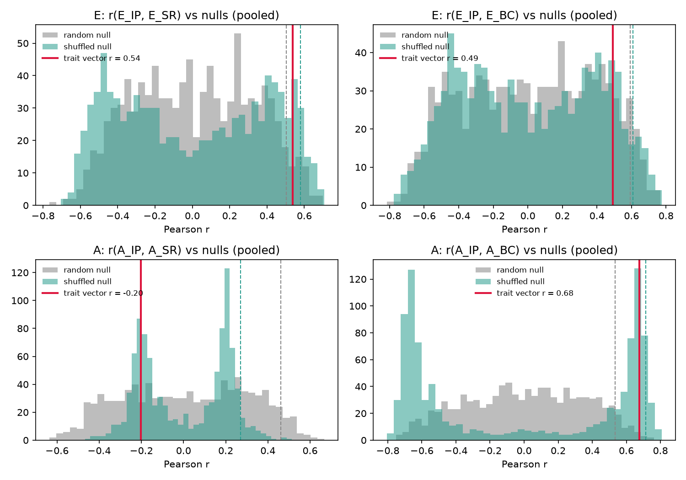

# Libra

**Do an LLM's questionnaire answers, its choices and its internal activations measure the same personality trait?**

Libra is a preregistered construct-validity study. It measures two Big Five traits, Extraversion and Agreeableness, in one open-weight language model with three independent methods, and tests whether they agree, using the multitrait–multimethod (MTMM) logic from personality psychology. It cost $0 to run: a free Kaggle GPU, open models and public-domain or CC-BY instruments.

→ **Full write-up: [`REPORT.md`](REPORT.md)** · Preregistration: [`PREREGISTRATION.md`](PREREGISTRATION.md) (git tag `prereg-v2`)



---

## Main result

For Extraversion, a questionnaire, a forced-choice behavior test and an activation "persona vector" agree across 96 personas. For Agreeableness, choices and activations agree, but the model's self-report agrees with neither. The persona vectors are not shown to be trait-specific: random directions in activation space correlate with the trait scores about as strongly, because between-persona variation is dominated by a few directions, mainly prompt style.

## Key findings

All results are for `microsoft/Phi-3.5-mini-instruct` across 96 persona prompts. Verdicts follow the preregistered rules, and each had to hold under two bootstrap schemes.

1. **Extraversion converges across all three methods.** The questionnaire, the forced-choice behavior test and the activation projection all agree (r = .79, .54, .49). That includes 64 personas whose prompts never name a trait.
2. **Agreeableness splits.** Choices and activations agree (r = .68), but the model's self-report agrees with neither (r = .04, −.20). The A questionnaire turned out to be unreliable (α = .09 for implicit personas) and driven by acquiescence, the tendency to agree with statements regardless of content.
3. **The activation "persona vector" is not shown to be trait-specific.** In the specificity test, the trait vectors did not beat random or label-shuffled directions. Follow-up exploratory analysis found the cause: between-persona variation in activations is low-rank. One component (38% of variance) is the prompt style (explicit trait instruction vs. biographical sketch), and another (21%) is shared by all the trait scores. So almost any direction correlates with the traits.
4. **Questionnaires are the weakest instrument here.** Extraversion self-report tracks overall agreement level (r = .95 with an acquiescence index), and it responds to intended Agreeableness about as much as to intended Extraversion.

**Takeaway:** high correlations between a persona vector and behavior are not, on their own, evidence that the vector measures the trait. A null-direction control is essential, and in this model it was not passed.

| Hypothesis (pooled, N = 96) | Extraversion | Agreeableness |
|---|---|---|
| H1 Convergent validity | **holds** | fails (self-report) |
| H2 Discriminant validity | fails (1 of 6 checks) | fails |
| H3 IP–SR and IP–BC differ | no difference | **IP tracks BC far more than SR** (d = −.88, p < .001)* |
| H4 Specific vs. null directions | fails | fails |
| H5 SR–BC weaker for implicit personas | fails | **holds** |

\*With a caveat: the vectors were validated by steering BC, so H3 for A mainly shows how weak the A self-report is.



---

## How it works

Every score comes from a **single forward pass**, read from next-token probabilities or hidden states. Nothing is sampled, and there is no judge model and no human rating.

| Method | What the model does | Score |
|---|---|---|
| **SR**: self-report | Rates IPIP-NEO-120 statements about itself (A–E scale) | Expected rating from letter probabilities, averaged over two label orders, reverse-keyed |
| **BC**: behavioral choice | Picks one of four actions in TRAIT scenarios | P(high-trait options), averaged over two option orders |
| **IP**: internal projection | Reads 50 neutral questions | Cosine of the layer-17 residual with a mean-difference trait vector |

**Personas.** 32 explicit prompts ("You are a person who is very solitary and somewhat distrustful"), crossing 4 Extraversion levels with 4 Agreeableness levels. 64 implicit biographical sketches that convey the traits only through habits ("hosts potluck dinners for neighbors…"). One no-persona baseline. 8 separate dev personas were used only for piloting.

**Trait vectors.** Built from contrastive adjective prompts in a separate extraction set. The layer was chosen by held-out d′ (E 7.1, A 15.4 at layer 17). The vectors were validated by steering the baseline model and checking that its choices moved monotonically (ρ = 1.0 for both traits).

**Analysis.** A 6 × 6 MTMM matrix and five preregistered hypotheses. Paired percentile bootstraps (B = 10,000) are run both over conditions and over the 12 shared cue sentences in the implicit personas, and a verdict counts only if it passes both. There are Holm corrections, two null-vector distributions (random and label-shuffled), Spearman robustness checks, reliability, disattenuation and a 32-layer sweep.

---

## Research engineering

The project was built to make results hard to fool yourself with:

- **Preregistered, with the evidence in git history.** The analysis plan was frozen at tag `prereg-v2` before any test persona was run. The analysis code (`40433bf`) was committed before it read a single test score, and it refuses to run with uncommitted changes. Every ambiguity in the plan was logged in `DEVIATIONS.md` before the run.
- **Pinned inputs.** The main run refuses to start unless the trait-vector file matches a SHA-256 in the config. Every results directory records the git commit, model revision, library versions and vector hash.
- **The main run reports no outcomes.** While running it shows only data-quality statistics (option mass, exclusions, completeness), so nobody sees results before the analysis is fixed.
- **Report tables are generated, not typed.** `trait-mtmm report` writes every table in `REPORT.md` from the analysis outputs, and rerunning it reproduces the file byte for byte.
- **Tested statistics.** Weighted-bootstrap correlations are checked against brute-force expanded resamples. Synthetic datasets with known structure must pass the hypotheses, and pure-noise datasets must fail them. 46 tests in total; 42 run on CPU in seconds.
- **Resumable GPU runs on free hardware.** About 53,000 forward passes in the main run, with per-persona checkpoints, run from a Kaggle notebook that clones this repo.
- **Decisions logged.** `DECISIONS.md` records every choice and correction with its date and reason. That includes a failed first prompt format, a rewritten steering gate, and a flaw found in the stimuli before the preregistration was frozen.

---

## Reproduce

```bash
python -m venv .venv && source .venv/bin/activate
pip install -e ".[dev]"
pytest                       # fast CPU suite (smoke model; slow end-to-end tests excluded)
```

GPU stages (16 GB; free Kaggle tier via [`notebooks/run_kaggle.ipynb`](notebooks/run_kaggle.ipynb)):

```bash
python -m trait_mtmm.run phase4   # extract trait vectors, steering gate, dev pilot
python -m trait_mtmm.run main     # 96 test personas + baseline (needs pinned vectors)
```

CPU stages, run on the downloaded results:

```bash
python -m trait_mtmm.run phase7   # preregistered analysis + figures
python -m trait_mtmm.run report   # report tables + exploratory diagnostics → REPORT.md
```

To try the whole pipeline on CPU with a 135M smoke model (its numbers are meaningless): `python -m trait_mtmm.run smoke --config configs/smoke.yaml`.

TRAIT is a gated dataset. Rebuilding the BC items needs a Hugging Face token in a gitignored `.hf_token` file. The sampled items are already committed in `stimuli/bc_items.jsonl` (CC-BY-4.0).

## Repository map

| Path | Contents |
|---|---|
| `src/trait_mtmm/measures/` | SR, BC and IP scoring |
| `src/trait_mtmm/vectors.py` | Trait-vector extraction, layer selection, steering validation |
| `src/trait_mtmm/run.py` | CLI: `extract`, `phase4`, `main`, `phase7`, `report`, `smoke` |
| `src/trait_mtmm/mtmm.py` | Preregistered analysis (bootstraps, H1–H5, nulls, reliability) |
| `src/trait_mtmm/report.py` | Generated report tables and exploratory checks |
| `stimuli/` | Personas, IPIP items, TRAIT items, probe and extraction prompts |
| `figures/` | The six report figures |
| `PREREGISTRATION.md`, `DEVIATIONS.md`, `DECISIONS.md` | Frozen plan, clarifications, decision log |

## Limitations

- One 3.8B model, so this is a pilot, not a claim about LLMs in general.
- Forced choice measures stated intention, not behavior.
- Personas are designed conditions, not independent individuals. The 64 implicit personas share 12 cue sentences, which is handled with a cluster bootstrap.
- Content overlap between personas and items may inflate convergence despite the banned-terms lint.
- IP is one linear direction at one token position, which is only one of many possible internal measures.
- The IP–BC agreement is not independent of how the vectors were validated. BC items come from TRAIT and were not re-validated.

See [`REPORT.md` §7](REPORT.md#7-limitations) for the full list.

## What I'd do next

- More models and sizes, all five traits, open-ended behavior rated by people, and confirmatory factor analysis with method factors.
- Use a null built from vectors orthogonal to the trait direction (or from a different contrast), so that "trait-specific" can be told apart from "aligned with the dominant persona directions".
- Remove the prompt-genre component, or match persona styles, before projecting.
- Replace the Likert self-report with a forced-choice or balanced-keying format that resists acquiescence.

## Citation and license

Code: MIT ([`LICENSE`](LICENSE)). To cite, see [`CITATION.cff`](CITATION.cff). The stimuli keep their sources' licenses: IPIP is public domain, and TRAIT is CC-BY-4.0.
