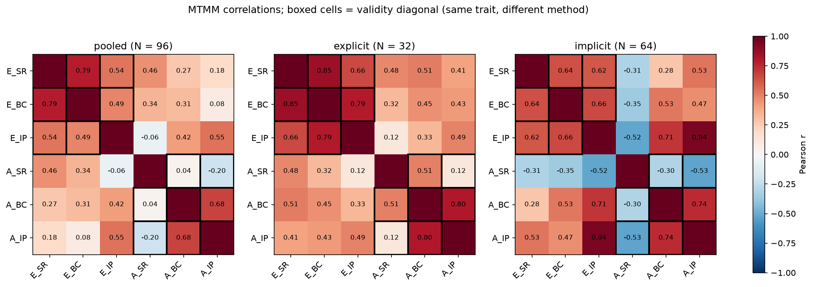
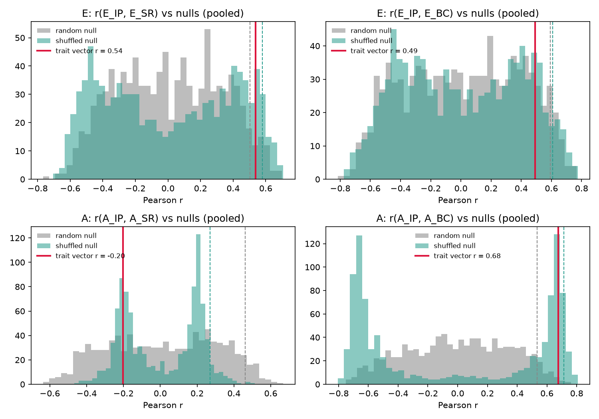
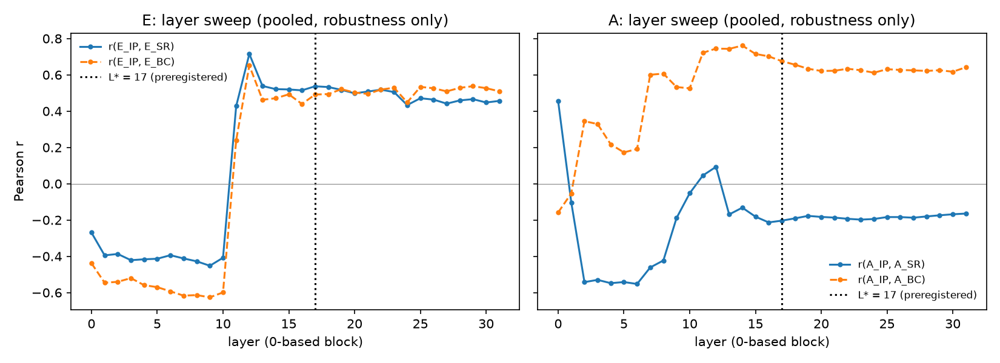
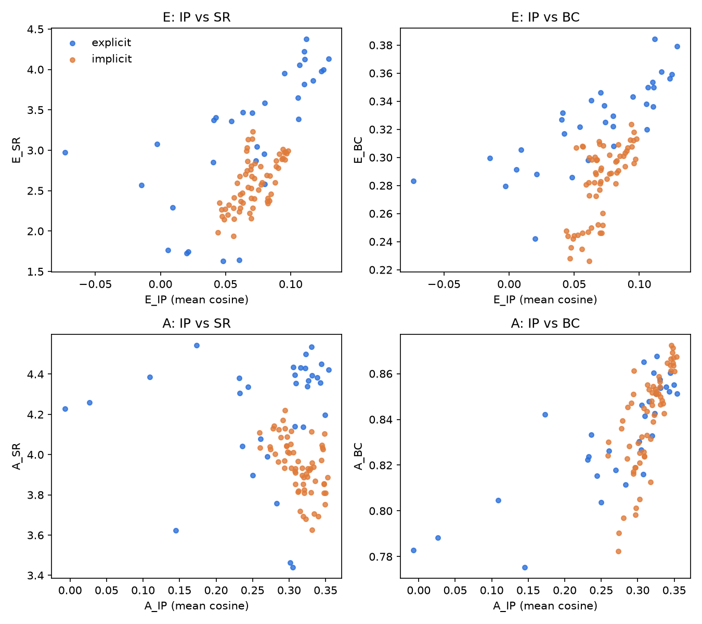
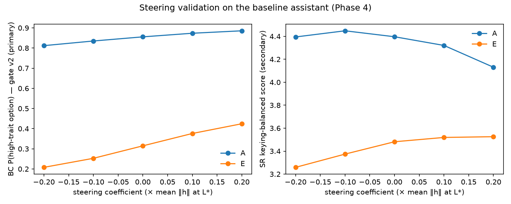
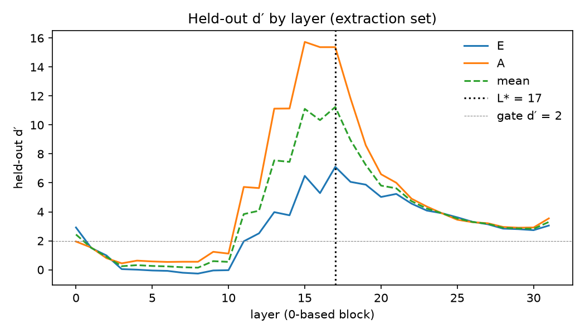

# Libra: a multitrait–multimethod pilot of self-report, behavioral-choice and internal-projection personality measures in one small language model

**Status:** released 2026-11-20 after owner review (HUMAN GATE G3).
**Preregistration:** `PREREGISTRATION.md`, tag `prereg-v2`. **Departures:** none. **Clarifications:** D1–D11 in `DEVIATIONS.md`, all committed before the analysis ran.

Every table between `<!-- BEGIN:… -->` and `<!-- END:… -->` markers is generated by `python -m trait_mtmm.run report` from the Phase 7 outputs, and the command overwrites those blocks on each run. Numbers in the prose are copied from those tables. Sections marked **exploratory** were not preregistered.

---

## Summary

We applied 96 persona system prompts (32 explicit, 64 implicit) and one no-persona baseline to `microsoft/Phi-3.5-mini-instruct`. Under each persona we scored Extraversion (E) and Agreeableness (A) three ways, each from next-token probabilities or activations in a single forward pass:

- **self-report (SR):** IPIP-NEO-120 items;
- **behavioral choice (BC):** TRAIT forced-choice scenarios;
- **internal projection (IP):** cosine of the last-token residual at layer 17 with a mean-difference trait vector.

We then tested five preregistered hypotheses on the 6 × 6 multitrait–multimethod (MTMM) matrix. Each verdict had to pass under two bootstraps: one that resamples conditions, and one that resamples the 12 implicit cue clusters.

- **Extraversion.** All three methods converge (H1 holds: r = .79 SR–BC, .54 SR–IP, .49 BC–IP). Discriminant validity (H2) fails on one of six comparisons: E_IP correlates about as strongly with A_BC (.42) as with E_BC (.49). IP is not significantly closer to SR than to BC (H3).
- **Agreeableness.** BC and IP converge (r = .68). SR does not converge with either (.04 with BC, −.20 with IP), so H1 and H2 fail. IP tracks BC far more than SR (H3: d = −.88, Holm p < .001). However, A_SR is unreliable (α = .58 pooled, .09 in the implicit set) and acquiescence-prone, and the IP vectors were accepted partly because steering them moved BC. This H3 result therefore says more about the A self-report than about IP.
- **Specificity (H4) fails for both traits.** The trait-vector correlations do not exceed the 95th percentile of both null distributions. Exploratory checks show why. The persona residuals vary along a few dominant directions: the first component separates explicit from implicit personas, and the second is shared by all trait scores. Random directions therefore correlate with trait scores about as strongly as the trait vectors do. The label-shuffled null keeps much of the trait signal, because the extraction poles are separated so far.
- **H5 (secondary).** SR–BC agreement is lower in the implicit set than in the explicit set for A, but not for E (E fails under the cluster bootstrap).

Overall: for this model, the E construct shows cross-method convergence, but an internal projection onto a mean-difference vector is **not** shown to be a trait-specific measure. The A comparison is limited by a weak self-report.

---

## 1. Research question

1. Do SR, BC and IP converge on the same trait and discriminate between traits?
2. Does IP track what the model says about itself (SR), what it chooses (BC), both, or neither?

This is a pilot on one 3.8B-parameter model. It makes no claims about LLMs in general, and it does not claim that forced-choice answers are real behavior.

## 2. Design

| Element | Decision |
|---|---|
| Model | `microsoft/Phi-3.5-mini-instruct`, revision `2fe192450127e6a83f7441aef6e3ca586c338b77`, float16 |
| Conditions | 96 test personas (32 explicit: 4 E levels × 4 A levels × 2 variants; 64 implicit biographical sketches, 16 per E × A quadrant) and 1 baseline; 8 separate dev personas |
| SR | IPIP-NEO-120 E and A domains (24 items each). Letter labels A–E. Each item scored in standard and reversed label order; expected value from next-token probabilities |
| BC | 100 TRAIT items per trait (`mirlab/TRAIT`, CC-BY-4.0). P(high-trait options) over 4 lettered options, in two option orders |
| IP | Mean over 50 neutral probes of cos(last-token residual at L*, trait vector) |
| Trait vectors | Normalized mean difference of high-pole minus low-pole adjective-prompt residuals, from 64 train prompts per pole. Layer chosen on held-out d′ |
| Scoring | Next-token probabilities and activations only; no sampling or generation |
| Unit of analysis | Persona condition (N = 96) |

**Vector extraction and validation** (Phase 4: extraction set and baseline steering only, no test personas). Steering moved BC monotonically for both traits. The rule was fixed in advance: Spearman ρ ≥ 0.9 and option mass ≥ 0.80. Steering A moved the keying-balanced SR score in the *opposite* direction (ρ −0.70), while raw agreement rose. That is the first sign of acquiescence in A_SR.

<!-- BEGIN:phase4 -->
| Trait | Held-out d′ at L* | Steering ρ (BC) | BC change −0.2→+0.2 | BC option mass | SR keying-balanced ρ (secondary) |
|---|---|---|---|---|---|
| E | 7.11 | 1.00 | 0.216 | 0.989 | 1.00 |
| A | 15.37 | 1.00 | 0.074 | 0.991 | −0.70 |

L* = 17 of 32 blocks; cos(v_E, v_A) at L* = 0.23.
<!-- END:phase4 -->

**Power** (prereg §4). With two-sided α = .05 and 80% power, the minimum detectable correlation is about .28 at N = 96, .34 at N = 64 and .48 at N = 32. These figures assume independent conditions. The 64 implicit personas use only 12 distinct cue sentences (5–6 personas each). The effective N for the implicit and pooled samples is therefore lower, and those figures are optimistic.

## 3. Procedure and integrity

- Prompt formats, layer and steering gate were chosen on the extraction set and the 8 dev personas only.
- The preregistration was frozen at tag `prereg-v2` before any test persona was run (HUMAN GATE G1, 2026-11-19).
- The main run used commit `dab96bb` on a free Kaggle GPU (HUMAN GATE G2). It refused to run without the pinned trait-vector file (SHA-256 `5e12b0ba…a402ca`). It reported only data-quality statistics.
- The analysis code (`src/trait_mtmm/mtmm.py`) was committed at `40433bf` before it read any test score. The command that runs it refuses to start with uncommitted code changes.
- Where the prereg needed a concrete reading, the reading was logged before the run (`DEVIATIONS.md`, D1–D11). No rule was changed.

**Data quality.**
- SR next-token mass on the five answer letters averaged 0.99995 (minimum 0.983).
- BC mass on the four option letters averaged 0.998 (minimum 0.580).
- No item fell below the 0.50 exclusion threshold, so no condition score was excluded.
- No IP score was non-finite.
- The cached residuals reproduce every IP score to within 1.4 × 10⁻⁸.

<!-- BEGIN:samples -->
| Sample | Conditions | Listwise N | Excluded | Bootstrap clusters |
|---|---|---|---|---|
| pooled | 96 | 96 | 0 | 44 |
| explicit | 32 | 32 | 0 | 32 |
| implicit | 64 | 64 | 0 | 12 |
<!-- END:samples -->

## 4. Results

### 4.1 Preliminary checks (prereg §3.1; descriptive)

**Manipulation check.** The table gives the correlation of each score with the intended level. "Same" means the intended level of the same trait; "cross" means the other trait. Explicit personas use levels 1–4. Implicit and pooled samples use pole coding (0/1), because only the pole is present in the implicit text.

<!-- BEGIN:manipulation -->
| Score | pooled same | explicit same | implicit same | pooled cross | explicit cross | implicit cross |
|---|---|---|---|---|---|---|
| E_SR | 0.49 | 0.72 | 0.46 | 0.40 | 0.51 | 0.51 |
| E_BC | 0.56 | 0.70 | 0.67 | 0.25 | 0.40 | 0.23 |
| E_IP | 0.48 | 0.73 | 0.20 | 0.21 | 0.28 | 0.24 |
| A_SR | 0.27 | 0.67 | 0.02 | −0.06 | −0.08 | −0.10 |
| A_BC | 0.53 | 0.77 | 0.37 | 0.08 | 0.08 | 0.09 |
| A_IP | 0.36 | 0.59 | 0.30 | 0.10 | 0.17 | 0.01 |
<!-- END:manipulation -->

Every measure tracks the explicit instructions (same-trait r .59–.77). With implicit personas, E_BC (.67) and E_SR (.46) still follow the intended E pole. A_SR does not respond to the implicit A cues at all (.02). E_SR also correlates with the intended *A* level (.40 pooled, .51 in both sets). Its cross-trait correlations are about as large as its same-trait correlation.

**Reliability.** Cronbach's α for SR and BC; for IP, odd–even probe split-half with the Spearman–Brown correction.

<!-- BEGIN:reliability -->
| Variable | Index | pooled | explicit | implicit |
|---|---|---|---|---|
| E_SR | cronbach alpha | 0.93 | 0.96 | 0.85 |
| E_BC | cronbach alpha | 0.92 | 0.93 | 0.88 |
| E_IP | split half spearman brown | 1.00 | 1.00 | 0.99 |
| A_SR | cronbach alpha | 0.58 | 0.70 | 0.09 |
| A_BC | cronbach alpha | 0.89 | 0.93 | 0.90 |
| A_IP | split half spearman brown | 1.00 | 1.00 | 1.00 |
<!-- END:reliability -->

A_SR is the weak instrument: α = .58 pooled and .09 in the implicit set. IP split-half reliability is ≈ 1.00. Because the probe means barely depend on which probes are used, IP scores are dominated by the persona prompt, not by the probes.

### 4.2 MTMM matrices (figure 1)

Pearson correlations. The validity diagonal holds same-trait, different-method pairs: E_SR–E_BC, E_SR–E_IP and E_BC–E_IP, and the same for A.

**Pooled (primary, N = 96)**
<!-- BEGIN:mtmm_pooled -->
|  | E_SR | E_BC | E_IP | A_SR | A_BC | A_IP |
|---|---|---|---|---|---|---|
| E_SR | 1 | 0.79 | 0.54 | 0.46 | 0.27 | 0.18 |
| E_BC | 0.79 | 1 | 0.49 | 0.34 | 0.31 | 0.08 |
| E_IP | 0.54 | 0.49 | 1 | −0.06 | 0.42 | 0.55 |
| A_SR | 0.46 | 0.34 | −0.06 | 1 | 0.04 | −0.20 |
| A_BC | 0.27 | 0.31 | 0.42 | 0.04 | 1 | 0.68 |
| A_IP | 0.18 | 0.08 | 0.55 | −0.20 | 0.68 | 1 |
<!-- END:mtmm_pooled -->

**Explicit (N = 32)**
<!-- BEGIN:mtmm_explicit -->
|  | E_SR | E_BC | E_IP | A_SR | A_BC | A_IP |
|---|---|---|---|---|---|---|
| E_SR | 1 | 0.85 | 0.66 | 0.48 | 0.51 | 0.41 |
| E_BC | 0.85 | 1 | 0.79 | 0.32 | 0.45 | 0.43 |
| E_IP | 0.66 | 0.79 | 1 | 0.12 | 0.33 | 0.49 |
| A_SR | 0.48 | 0.32 | 0.12 | 1 | 0.51 | 0.12 |
| A_BC | 0.51 | 0.45 | 0.33 | 0.51 | 1 | 0.80 |
| A_IP | 0.41 | 0.43 | 0.49 | 0.12 | 0.80 | 1 |
<!-- END:mtmm_explicit -->

**Implicit (N = 64; 12 cue clusters)**
<!-- BEGIN:mtmm_implicit -->
|  | E_SR | E_BC | E_IP | A_SR | A_BC | A_IP |
|---|---|---|---|---|---|---|
| E_SR | 1 | 0.64 | 0.62 | −0.31 | 0.28 | 0.53 |
| E_BC | 0.64 | 1 | 0.66 | −0.35 | 0.53 | 0.47 |
| E_IP | 0.62 | 0.66 | 1 | −0.52 | 0.71 | 0.94 |
| A_SR | −0.31 | −0.35 | −0.52 | 1 | −0.30 | −0.53 |
| A_BC | 0.28 | 0.53 | 0.71 | −0.30 | 1 | 0.74 |
| A_IP | 0.53 | 0.47 | 0.94 | −0.53 | 0.74 | 1 |
<!-- END:mtmm_implicit -->

### 4.3 Hypotheses H1–H3 (pooled, Pearson)

Each statistic is shown with its estimate and its 95% percentile interval under both bootstraps (B = 10,000, seed 42). A component passes only if its interval is above zero under **both** bootstraps. H3 is two-sided, uses the larger of the two bootstrap p values, and is Holm-corrected over the two traits. H2 compares against **absolute** heterotrait correlations, which is stricter than the signed comparison of Campbell & Fiske.

<!-- BEGIN:h123_pooled -->
| H | Trait | Statistic | Estimate | 95% CI (condition) | 95% CI (cluster) | Result |
|---|---|---|---|---|---|---|
| H1 | E | r(E_SR,E_BC) | 0.79 | [0.70, 0.86] | [0.69, 0.87] | pass |
| H1 | E | r(E_SR,E_IP) | 0.54 | [0.34, 0.75] | [0.34, 0.75] | pass |
| H1 | E | r(E_BC,E_IP) | 0.49 | [0.35, 0.65] | [0.33, 0.67] | pass |
| H1 | A | r(A_SR,A_BC) | 0.04 | [−0.15, 0.22] | [−0.20, 0.34] | fail |
| H1 | A | r(A_SR,A_IP) | −0.20 | [−0.39, 0.02] | [−0.40, 0.06] | fail |
| H1 | A | r(A_BC,A_IP) | 0.68 | [0.57, 0.77] | [0.54, 0.82] | pass |
| H2 | E | r(E_SR,E_BC) − \|r(E_SR,A_BC)\| | 0.52 | [0.34, 0.71] | [0.29, 0.77] | pass |
| H2 | E | r(E_SR,E_BC) − \|r(A_SR,E_BC)\| | 0.45 | [0.30, 0.62] | [0.21, 0.69] | pass |
| H2 | E | r(E_SR,E_IP) − \|r(E_SR,A_IP)\| | 0.36 | [0.14, 0.60] | [0.13, 0.60] | pass |
| H2 | E | r(E_SR,E_IP) − \|r(A_SR,E_IP)\| | 0.47 | [0.02, 0.64] | [0.02, 0.65] | pass |
| H2 | E | r(E_BC,E_IP) − \|r(E_BC,A_IP)\| | 0.41 | [0.23, 0.58] | [0.22, 0.58] | pass |
| H2 | E | r(E_BC,E_IP) − \|r(A_BC,E_IP)\| | 0.07 | [−0.15, 0.28] | [−0.16, 0.34] | fail |
| H2 | A | r(A_SR,A_BC) − \|r(A_SR,E_BC)\| | −0.30 | [−0.54, −0.04] | [−0.61, 0.03] | fail |
| H2 | A | r(A_SR,A_BC) − \|r(E_SR,A_BC)\| | −0.23 | [−0.45, 0.01] | [−0.52, 0.11] | fail |
| H2 | A | r(A_SR,A_IP) − \|r(A_SR,E_IP)\| | −0.27 | [−0.66, −0.05] | [−0.68, −0.03] | fail |
| H2 | A | r(A_SR,A_IP) − \|r(E_SR,A_IP)\| | −0.38 | [−0.61, −0.13] | [−0.63, −0.10] | fail |
| H2 | A | r(A_BC,A_IP) − \|r(A_BC,E_IP)\| | 0.26 | [0.08, 0.44] | [0.06, 0.50] | pass |
| H2 | A | r(A_BC,A_IP) − \|r(E_BC,A_IP)\| | 0.60 | [0.37, 0.73] | [0.35, 0.77] | pass |
| H3 | E | r(E_IP,E_SR) − r(E_IP,E_BC) | 0.05 | [−0.08, 0.18] | [−0.09, 0.19] | bootstrap p = 0.482 (condition), = 0.518 (cluster); Holm p = 0.518; not significant |
| H3 | A | r(A_IP,A_SR) − r(A_IP,A_BC) | −0.88 | [−1.07, −0.69] | [−1.12, −0.61] | bootstrap p < 0.001 (condition), < 0.001 (cluster); Holm p < 0.001; significant |
<!-- END:h123_pooled -->

- **H1 (convergent validity):** holds for E; fails for A, because SR does not converge.
- **H2 (discriminant validity):** fails for both traits. For E, the one failing comparison is E_BC–E_IP (.49) against A_BC–E_IP (.42). For A, every comparison involving A_SR fails, and both BC–IP comparisons pass.
- **H3 (IP–SR vs IP–BC):** E shows no difference (d = .05). For A, IP tracks BC much more than SR (d = −.88). Interpretation caveat (prereg §1.3): the vectors were accepted partly because steering them moved BC, so IP–BC agreement is not independent of how the vectors were validated. SR played no part in that validation.

### 4.4 H4: specificity against null directions (figure 4)

Null IP scores replace the trait vector with (a) 1,000 random unit vectors, or (b) 1,000 vectors re-estimated with shuffled high/low extraction labels. Each target correlation must exceed the 95th percentile of the null correlations, in both nulls.

<!-- BEGIN:h4_pooled -->
| Corr | Comparison | Target r | Null p95 | Share of null below target | Result |
|---|---|---|---|---|---|
| pearson | r(E_IP,E_SR) > p95 random null | 0.54 | 0.50 | 0.96 | pass |
| pearson | r(E_IP,E_SR) > p95 shuffled null | 0.54 | 0.58 | 0.91 | fail |
| pearson | r(E_IP,E_BC) > p95 random null | 0.49 | 0.59 | 0.88 | fail |
| pearson | r(E_IP,E_BC) > p95 shuffled null | 0.49 | 0.61 | 0.87 | fail |
| pearson | r(A_IP,A_SR) > p95 random null | −0.20 | 0.46 | 0.28 | fail |
| pearson | r(A_IP,A_SR) > p95 shuffled null | −0.20 | 0.27 | 0.21 | fail |
| pearson | r(A_IP,A_BC) > p95 random null | 0.68 | 0.53 | 0.99 | pass |
| pearson | r(A_IP,A_BC) > p95 shuffled null | 0.68 | 0.71 | 0.85 | fail |
| spearman | r(E_IP,E_SR) > p95 random null | 0.59 | 0.50 | 0.99 | pass |
| spearman | r(E_IP,E_SR) > p95 shuffled null | 0.59 | 0.58 | 0.95 | pass |
| spearman | r(E_IP,E_BC) > p95 random null | 0.57 | 0.60 | 0.93 | fail |
| spearman | r(E_IP,E_BC) > p95 shuffled null | 0.57 | 0.63 | 0.90 | fail |
| spearman | r(A_IP,A_SR) > p95 random null | −0.22 | 0.45 | 0.27 | fail |
| spearman | r(A_IP,A_SR) > p95 shuffled null | −0.22 | 0.35 | 0.21 | fail |
| spearman | r(A_IP,A_BC) > p95 random null | 0.80 | 0.52 | 1.00 | pass |
| spearman | r(A_IP,A_BC) > p95 shuffled null | 0.80 | 0.82 | 0.92 | fail |
<!-- END:h4_pooled -->

H4 fails for both traits. The only comparisons that pass the primary Pearson test are E IP–SR and A IP–BC against the random null. The Spearman robustness check also passes E IP–SR against the shuffled null. See §5 for why the nulls are so wide.

### 4.5 H5: SR–BC agreement, explicit vs implicit (secondary)

<!-- BEGIN:h5 -->
| Corr | Trait | r explicit | r implicit | Δ | 95% CI (condition) | 95% CI (cluster) | Result |
|---|---|---|---|---|---|---|---|
| pearson | E | 0.85 | 0.64 | 0.21 | [0.06, 0.38] | [−0.03, 0.60] | fail |
| pearson | A | 0.51 | −0.30 | 0.81 | [0.51, 1.12] | [0.38, 1.25] | pass |
| spearman | E | 0.88 | 0.62 | 0.26 | [0.04, 0.46] | [−0.02, 0.70] | fail |
| spearman | A | 0.61 | −0.31 | 0.92 | [0.60, 1.17] | [0.43, 1.33] | pass |
<!-- END:h5 -->

H5 holds for A: SR–BC agreement is .51 in the explicit set and −.30 in the implicit set. For E it is .85 against .64; the condition-level interval excludes zero, but the cluster-bootstrap interval, which has only 12 implicit clusters, does not.

### 4.6 Verdicts across samples and correlation methods

Primary verdicts come from the pooled sample with Pearson correlations. The explicit and implicit samples and the Spearman versions are preregistered secondary and robustness analyses. "holds" means every component passed under both bootstraps.

<!-- BEGIN:verdict_summary -->
| Sample | Corr | H1 E | H1 A | H2 E | H2 A | H3 E | H3 A | H4 E | H4 A | H5 E | H5 A |
|---|---|---|---|---|---|---|---|---|---|---|---|
| pooled (primary) | pearson | holds | – | – | – | – | holds | – | – |  |  |
| pooled (primary) | spearman | holds | – | – | – | – | holds | – | – |  |  |
| explicit | pearson | holds | – | holds | – | – | holds | – | – |  |  |
| explicit | spearman | holds | holds | holds | – | – | holds | holds | – |  |  |
| implicit | pearson | holds | – | – | – | – | holds | holds | – |  |  |
| implicit | spearman | holds | – | – | – | – | holds | holds | – |  |  |
| explicit_vs_implicit | pearson |  |  |  |  |  |  |  |  | – | holds |
| explicit_vs_implicit | spearman |  |  |  |  |  |  |  |  | – | holds |
<!-- END:verdict_summary -->

The Spearman verdicts are identical to the Pearson verdicts in the pooled sample. In the explicit set, H1 and H2 hold for E, and H1 for A holds with Spearman. This partly resembles the §3.4 row "Convergence in the explicit set only". The row's operational definition (D7) is not met, because H1 for E also holds in the implicit set.

### 4.7 Outcome interpretation (prereg §3.4, definitions D7)

<!-- BEGIN:outcome_patterns -->
| Trait | Matching §3.4 rows |
|---|---|
| E | IP tracks neither, or fails H4 |
| A | IP tracks BC more than SR; IP tracks neither, or fails H4 |
<!-- END:outcome_patterns -->

### 4.8 Further preregistered analyses (no verdicts)

**Disattenuated correlations (pooled).**

<!-- BEGIN:disattenuated -->
| Pair | r | Disattenuated r |
|---|---|---|
| E_SR – E_BC | 0.79 | 0.85 |
| E_SR – E_IP | 0.54 | 0.56 |
| E_SR – A_SR | 0.46 | 0.62 |
| E_SR – A_BC | 0.27 | 0.29 |
| E_SR – A_IP | 0.18 | 0.19 |
| E_BC – E_IP | 0.49 | 0.51 |
| E_BC – A_SR | 0.34 | 0.46 |
| E_BC – A_BC | 0.31 | 0.35 |
| E_BC – A_IP | 0.08 | 0.08 |
| E_IP – A_SR | −0.06 | −0.08 |
| E_IP – A_BC | 0.42 | 0.45 |
| E_IP – A_IP | 0.55 | 0.55 |
| A_SR – A_BC | 0.04 | 0.05 |
| A_SR – A_IP | −0.20 | −0.27 |
| A_BC – A_IP | 0.68 | 0.72 |
<!-- END:disattenuated -->

Correcting for unreliability barely changes the validity diagonal, so measurement error does not explain the A_SR failures. A_SR shares little true-score variance with A_BC or A_IP (disattenuated .05 and −.27).

**Layer sweep (pooled, Pearson; figure 3).** IP is recomputed at each layer with that layer's vector. This is a robustness check only: L* = 17 remains the preregistered layer.

<!-- BEGIN:layer_sweep -->
| Layer | r(E_IP, E_SR) | r(E_IP, E_BC) | r(A_IP, A_SR) | r(A_IP, A_BC) |
|---|---|---|---|---|
| 0 | −0.27 | −0.44 | 0.46 | −0.16 |
| 4 | −0.42 | −0.56 | −0.55 | 0.22 |
| 8 | −0.43 | −0.61 | −0.42 | 0.61 |
| 11 | 0.43 | 0.24 | 0.05 | 0.72 |
| 12 | 0.72 | 0.65 | 0.09 | 0.74 |
| 14 | 0.52 | 0.47 | −0.13 | 0.76 |
| 17 (L*) | 0.54 | 0.49 | −0.20 | 0.68 |
| 20 | 0.50 | 0.50 | −0.18 | 0.62 |
| 24 | 0.43 | 0.45 | −0.19 | 0.61 |
| 28 | 0.46 | 0.53 | −0.18 | 0.62 |
| 31 | 0.46 | 0.51 | −0.16 | 0.64 |
<!-- END:layer_sweep -->

From about layer 12 onward, the correlations are stable, and the value at L* = 17 is typical of the later layers. Layer 12 gives higher E correlations (.72 / .65). This was not chosen in advance and is not used for any inference. In early layers (before 11), the signs are unstable, where the held-out d′ of the vectors is low (figure 6).

**SR acquiescence index (prereg §1.5).** For each condition and trait, the mean item response before reverse-keying.

<!-- BEGIN:acquiescence -->
| Sample | Index | Mean | r with E_SR | r with A_SR |
|---|---|---|---|---|
| pooled | ACQ_E | 2.70 | 0.95 | 0.41 |
| pooled | ACQ_A | 2.35 | 0.45 | 0.01 |
| explicit | ACQ_E | 3.02 | 0.97 | 0.51 |
| explicit | ACQ_A | 2.19 | 0.79 | 0.77 |
| implicit | ACQ_E | 2.54 | 0.84 | −0.48 |
| implicit | ACQ_A | 2.42 | 0.66 | −0.50 |
<!-- END:acquiescence -->

E_SR almost coincides with the E acquiescence index (r = .95 pooled), so E_SR variation is largely a shift in the overall level of agreement. In the implicit set, both acquiescence indices correlate negatively with A_SR (−.48 and −.50).

**Baseline (no persona; descriptive).**

<!-- BEGIN:baseline -->
| E_SR | E_BC | E_IP | A_SR | A_BC | A_IP |
|---|---|---|---|---|---|
| 3.663 | 0.315 | 0.119 | 4.362 | 0.856 | 0.372 |
<!-- END:baseline -->

**IP vs SR and BC scatter plots** (figure 2):

**Phase 4 figures:** steering curves (figure 5) and held-out d′ by layer (figure 6).

## 5. Exploratory analyses (not preregistered)

These analyses were added after the results were seen, to understand why H4 failed. They are computed by `src/trait_mtmm/report.py`. They change no verdict.

**Spread of the null distributions.** Both nulls are centered on zero but very wide.

<!-- BEGIN:null_spread -->
| Null | Trait | Target | Mean r | SD r | p95 |
|---|---|---|---|---|---|
| random | E | SR | 0.01 | 0.32 | 0.50 |
| random | E | BC | 0.02 | 0.38 | 0.59 |
| random | A | SR | 0.01 | 0.29 | 0.46 |
| random | A | BC | 0.00 | 0.35 | 0.53 |
| shuffled | E | SR | 0.01 | 0.39 | 0.58 |
| shuffled | E | BC | 0.01 | 0.39 | 0.61 |
| shuffled | A | SR | 0.01 | 0.21 | 0.27 |
| shuffled | A | BC | −0.01 | 0.61 | 0.71 |
<!-- END:null_spread -->

**Between-persona structure of the IP residuals.** We ran a PCA of the probe-averaged unit residuals at L* across the 96 personas. The table gives |r| between each component's scores and the six trait scores, plus an indicator for implicit personas.

<!-- BEGIN:expl_pca -->
| Component | Variance share | \|r\| E_SR | \|r\| E_BC | \|r\| E_IP | \|r\| A_SR | \|r\| A_BC | \|r\| A_IP | \|r\| is_implicit |
|---|---|---|---|---|---|---|---|---|
| PC1 | 0.38 | 0.31 | 0.47 | 0.25 | 0.46 | 0.31 | 0.66 | 0.92 |
| PC2 | 0.21 | 0.50 | 0.54 | 0.61 | 0.02 | 0.62 | 0.73 | 0.29 |
| PC3 | 0.06 | 0.20 | 0.21 | 0.58 | 0.21 | 0.12 | 0.14 | 0.17 |

Top 10 components together: 0.87 of between-persona variance.
<!-- END:expl_pca -->

Persona residuals vary along a few directions:
- **PC1 (38% of the variance)** is almost entirely the explicit-versus-implicit distinction (|r| = .92 with the set indicator). It reflects the prompt genre: a one-line trait instruction versus a biographical sketch.
- **PC2 (21%)** correlates with five of the six trait scores (|r| .50–.73), but not with A_SR (.02).

Any unit vector, random or not, picks up part of PC1 and PC2. That is why random directions reach |r| ≈ .5 with the trait scores. The trait vectors' correlations sit inside that range, so they cannot be called trait-specific by this test. The same structure probably also explains why E_IP and A_IP correlate .55 pooled and .94 in the implicit set.

**The label-shuffled null still contains the trait.** The extraction poles are separated by d′ 7.1 (E) and 15.4 (A). A random relabeling that leaves an imbalance of true highs between the two groups still yields a vector close to ±v_T.

<!-- BEGIN:expl_shuffle -->
| Trait | Mean \|cos(shuffled vector, v_T)\| | Share with \|cos\| > 0.5 |
|---|---|---|
| E | 0.36 | 0.29 |
| A | 0.48 | 0.50 |
<!-- END:expl_shuffle -->

Half of the A shuffled vectors have |cos| > 0.5 with v_A. The A shuffled null for IP–BC is bimodal, with modes near ±.68 (figure 4). Comparing against this null is therefore stricter than a trait-free null would be. For future work, a null built from vectors orthogonal to v_T, or from a different contrast, would separate "specific to the trait" from "aligned with the dominant persona directions" more cleanly. That is a design note, not a reanalysis.

## 6. Discussion

**What the pilot supports.**
- For Extraversion, a questionnaire, a forced-choice behavior test and an activation projection agree across 96 personas, including the 64 implicit personas whose text never names a trait.
- For Agreeableness, BC and IP agree with each other but not with the questionnaire.

**What it does not support.**
- *IP as a trait measure.* The mean-difference projection fails the preregistered specificity test for both traits. Exploratory analysis points to the cause: between-persona variation in the residuals is concentrated in a few directions tied to prompt genre and a general trait-like factor. Any direction correlates with the trait scores through them. A high IP–BC or IP–SR correlation in this design is therefore weak evidence that the vector itself carries the trait.
- *"IP tracks behavior, not self-report."* The A result in H3 is large, but it comes from an A self-report that is unreliable and insensitive to implicit cues. In Phase 4, its keying-balanced score also moved against the steering direction while raw agreement rose. And BC was used to validate the vectors (§1.3). A defensible statement is narrower: for A in this model, IP and BC agree with each other, and SR agrees with neither.

**Self-report.** E_SR is driven by general agreement level (r = .95 with the acquiescence index) and responds to the intended A level about as much as to the intended E level. Discriminant validity of SR therefore rests partly on keying artifacts. That matches the acquiescence risk recorded before the main run (prereg §1.4) and the negative SR steering curve for A in Phase 4.

## 7. Limitations

- One model and one pilot: no claims about other models or about LLMs in general.
- Forced-choice answers are not real behavior.
- The implicit personas encode only their quadrant, through 12 cue sentences. The effective N is below 64 (and below 96 pooled). The cluster bootstrap addresses this for inference; the power figures do not.
- The trait vectors were validated by steering BC, so IP–BC estimates are not independent of that validation (prereg §1.3).
- The hypothesis wording (H1–H5) was transcribed from the plan, whose source brief is not in the repository. The owner accepted it at G1 without checking it against the brief.
- Manipulation checks for implicit personas use pole coding only.
- IP reliability near 1.0 reflects a persona-dominated residual, not trait precision.

## 8. Related work

These references were checked in Phase 0 (`DECISIONS.md`). No prior study combining SR, BC and activation-based measures in one MTMM under shared persona conditions was found as of 2026-11-16.

- Campbell & Fiske (1959): the multitrait–multimethod matrix.
- Serapio-García et al. (arXiv:2307.00184): MTMM across two LLM personality questionnaires (IPIP-NEO, BFI).
- Lee et al., TRAIT (arXiv:2406.14703; NAACL 2025 Findings): the BC item source.
- Han et al. (arXiv:2509.03730): LLM self-report and behavior dissociate.
- arXiv:2606.09843: an LLM-native self-report instrument; self-report does not predict human-rated open-ended behavior (mean r ≈ .09).
- Chen et al., persona vectors (arXiv:2507.21509); PERSONA (arXiv:2602.15669, ICLR 2026): activation trait vectors for monitoring and control.
- arXiv:2602.15847: Big Five steering vectors are geometrically entangled (cf. cos(v_E, v_A) = .23 here).
- Lu et al., Assistant Axis (arXiv:2601.10387); IRIS (arXiv:2604.13846, ACL 2026 Findings); Zeng et al. (arXiv:2607.13162): persona structure and auditing in activation space.
- Johnson (2014): IPIP-NEO-120. Goldberg (1992): Big Five adjective markers.

## 9. Reproducibility

| Step | Command | Commit |
|---|---|---|
| Extraction, gates and dev pilot (GPU) | `python -m trait_mtmm.run phase4` | `675f7f6` |
| Main run (GPU) | `python -m trait_mtmm.run main` | `dab96bb` |
| Preregistered analysis (CPU, seconds) | `python -m trait_mtmm.run phase7` | `40433bf` |
| Report tables and exploratory checks | `python -m trait_mtmm.run report` | this commit |

Software:
- GPU runs: Python 3.13.16, torch 2.11.0+cu130, transformers 5.20.2.
- All randomness is seeded from `configs/default.yaml` (seed 42; shuffle nulls 43/44).
- Each results directory holds a `provenance.json` with the git commit, model revision, library versions and trait-vector hash.

The six report figures (`figures/main_*.png`, written by `phase7`) are committed. Results files (`results/`: item-level scores, residual caches of about 1 GB, analysis tables) are gitignored and are not in the repository.
